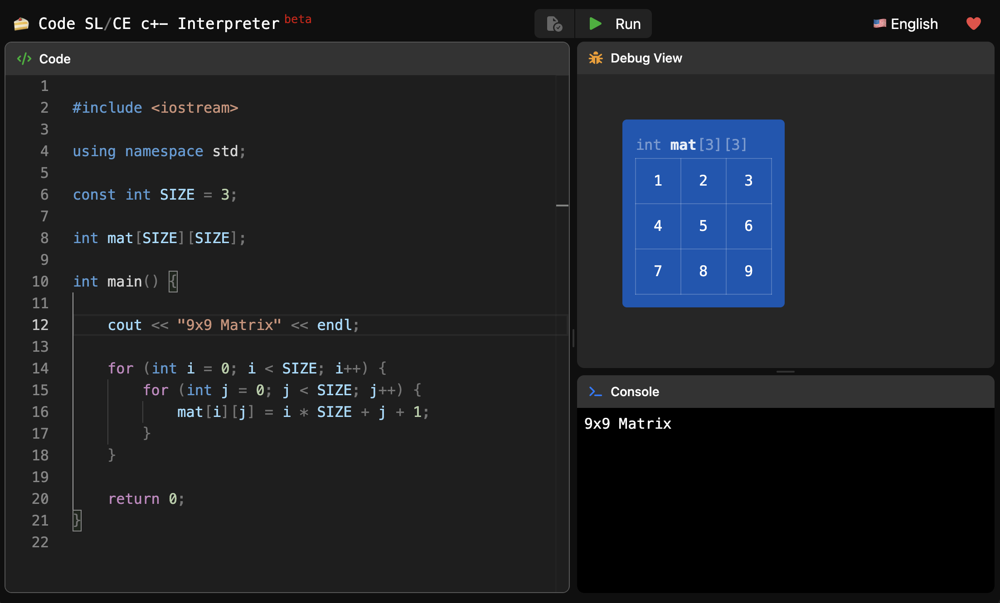

# Snake SL/CE

Web interpreter for `python`, made with ❤️ to help students.

## Features

- [x] Debug view of variables, lists and lists of lists (matrices)
- [x] Variable Scoping view (dashed box per function call and list comprehension in the debug view)
- [x] List initializers: `[1, 2, 3]`, `[[1, 2], [3, 4]]`, also written on several lines (with a trailing comma and comments)
